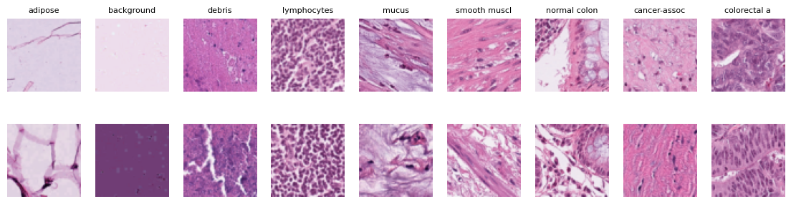

# Real-Time Two-Stage Pathology Frame Triage

A prototype for real-time AI assessment of microscope frames under a **33 frames-per-second budget (~30 ms per frame)** on a single GPU, with no cloud at inference time.

## The problem
A live microscope produces a continuous stream of frames. Many of them contain nothing worth assessing (background, debris, fat, mucus). Running a large classifier on every frame wastes the time budget. The goal: skip the empty frames quickly, and spend compute only where there is tissue to assess, **without missing suspicious tissue**.

## Approach: two models instead of one
| Stage | Model | Job |
|---|---|---|
| 1. Gate | TinyGate: 4-layer CNN, **60,818 parameters** | Decide fast: is there tissue worth assessing in this frame? |
| 2. Classifier | ResNet50, ImageNet-pretrained (transfer learning) | Only on frames that pass the gate: **suspicious** (tumor epithelium) vs **benign** |

- Both models run in **FP16 (half precision)** with channels-last memory layout for faster GPU inference.
- Thresholds were set to favor **sensitivity**: a missed suspicious frame is worse than a false alarm.
- Gate threshold = 0.1, classifier threshold = 0.3.

## Data
[PathMNIST](https://medmnist.com/) (MedMNIST v3), 64×64 H&E colon tissue patches, 9 classes.
- Train 89,996 · Validation 10,004 · Test 7,180
- **Skipped by gate:** adipose, background, debris, mucus
- **Assessed:** lymphocytes, smooth muscle, normal mucosa, cancer-associated stroma, tumor epithelium (suspicious)

## Results (test set, NVIDIA Tesla T4)

### Speed: one frame at a time, like a live stream (1,000 frames)
| Pipeline | Avg latency | p99 latency | Throughput |
|---|---|---|---|
| Classifier on every frame | 6.78 ms | 8.66 ms | 148 fps |
| **Gate + classifier** | **4.95 ms** | 9.36 ms | **202 fps** |

- The two-stage pipeline cut average latency by **~27%**. The classifier ran on only 614 of 1,000 frames.
- Both pipelines stay well inside the 30.3 ms budget for 33 fps.
- Worst-case (p99) latency is slightly higher with the gate, because frames that pass the gate pay for both models. Average throughput improves; the worst case does not.

### Gate
| Threshold | Tissue frames kept | Empty frames skipped |
|---|---|---|
| 0.5 | 94.97% | 86.93% |
| 0.2 | 96.82% | 78.22% |
| **0.1 (chosen)** | **97.46%** | **71.03%** |
| 0.05 | 98.07% | 63.95% |

A low threshold was chosen on purpose: the gate should rarely throw away real tissue.

### Classifier (tissue frames only)
| Threshold | Sensitivity | Specificity | Missed suspicious |
|---|---|---|---|
| 0.5 | 97.00% | 97.65% | 37 |
| **0.3 (chosen)** | **97.40%** | **96.19%** | **32** |
| 0.1 | 98.46% | 94.93% | 19 |

### End to end (all 7,180 test frames)
- **97.40%** of suspicious frames caught (32 missed of 1,233)
- **1.95%** of non-suspicious frames wrongly flagged
- **36.49%** of frames skipped by the gate
- The gate added **no** extra missed suspicious frames compared to running the classifier alone (32 vs 32). The tissue frames it dropped were benign ones.

## What I learned / limitations
- **Domain shift is real.** Validation accuracy was 99.8%, but test sensitivity was 97.4%. PathMNIST's test set comes from a different source than its training set. In a real deployment, this is why a model must be validated on data from each new site, microscope, and staining protocol.
- **Thresholds were picked on the test set.** For an unbiased estimate, they should be tuned on the validation set and the test set used only once. This is the first thing I would fix.
- **Results vary between runs.** No random seed is fixed; a second run gave 96.4% suspicious caught and 29% lower latency. Fixing seeds and reporting the mean over several runs would make results more reliable.
- **Small images understate the benefit.** These are 64×64 patches. Real microscope frames are much larger, so the classifier costs more per frame and skipping frames saves more time.
- **Not cytology.** This is H&E tissue, not live rapid on-site cytology frames. The pipeline design transfers; the models would need to be retrained on real frames.
- The classifier's training loss reached ~0, a sign it may be memorizing; stronger augmentation (color/stain jitter) could improve generalization to new sites.

## Next steps
- Tune thresholds on validation data only; fix seeds; report the mean over several runs
- Export to ONNX → TensorRT with INT8 quantization
- Add a classical focus/blur check (Laplacian variance) before the gate to drop out-of-focus frames almost for free
- Stain augmentation to reduce domain shift
- Try on cytology image datasets and full-resolution frames

## How to run
Open `realtime-pathology-triage.ipynb` in Kaggle or Google Colab with a **T4 GPU** and internet on, then run all cells. Training takes about 5 minutes in total.

**Stack:** Python, PyTorch, torchvision, MedMNIST, scikit-learn, NumPy, Matplotlib
